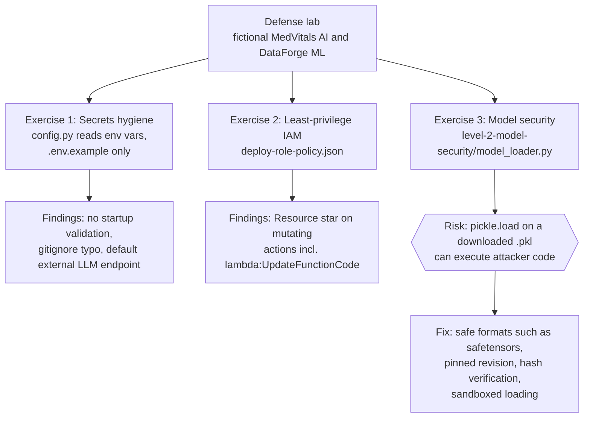
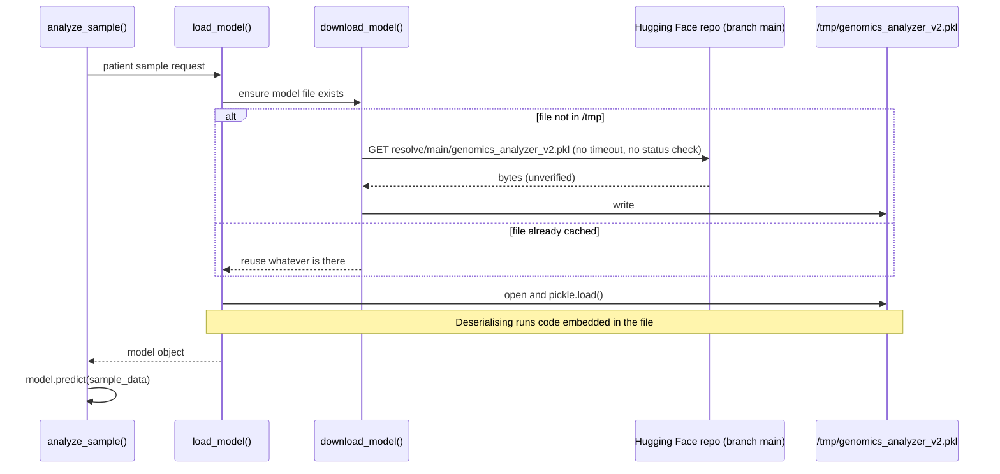

<div align="center">

# AI Security Defense Lab

**Hands-on exercises in hardening AI/ML systems: secrets handling, least-privilege IAM and unsafe model loading.**

    

</div>

> **WARNING: this repository contains intentionally vulnerable example code** (`level-2-model-security/model_loader.py`) and an intentionally over-permissive IAM policy (`deploy-role-policy.json`). They exist to be read, attacked in a safe sandbox and fixed. **Do not copy them into a real project and do not run the loader against real data.** Both fictional companies (MedVitals AI, DataForge ML) and all identifiers are made up for the exercises.

Last updated: 2026-11-03.

---

## Contents

- [Why this lab exists](#why-this-lab-exists)
- [Repository layout](#repository-layout)
- [Tech stack](#tech-stack)
- [Lab map](#lab-map)
- [Exercise 1: Secrets hygiene](#exercise-1-secrets-hygiene)
- [Exercise 2: Least-privilege IAM](#exercise-2-least-privilege-iam)
- [Exercise 3: Unsafe model loading](#exercise-3-unsafe-model-loading)
- [Defense checklist](#defense-checklist)
- [How to use this lab](#how-to-use-this-lab)
- [Limitations](#limitations)

## Why this lab exists

AI systems add supply-chain risk that ordinary web apps do not have: model files are executable artefacts downloaded from third parties, prompts and data may include personal information, and cloud roles for ML pipelines tend to grow broad permissions. The lab walks through three concrete findings in two fictional systems:

| System (fictional) | Domain | What is in this repo |
|---|---|---|
| MedVitals AI | Health AI service | `config.py`, `.env.example`, `deploy-role-policy.json` |
| DataForge ML | Genomics analysis pipeline | `level-2-model-security/model_loader.py` |

Both handle sensitive data (health and genomic information), which is why the findings matter: under Thai PDPA this is sensitive personal data and a compromise would be a reportable incident.

## Repository layout

```
ai-security-defense-lab/
├── config.py                               MedVitals AI settings, secrets read from environment variables
├── .env.example                            Template of variable names (placeholders only; real .env is git-ignored)
├── .gitignore                              Ignores .env, .env.local, venvs, caches
├── deploy-role-policy.json                 AWS IAM policy to review: one over-broad statement, one scoped statement
├── level-2-model-security/
│   └── model_loader.py                     DataForge loader: downloads a .pkl from Hugging Face and pickle.load()s it (VULNERABLE)
└── README.md
```

## Tech stack

| Layer | Used in the lab |
|---|---|
| Language | Python 3 (`os`, `pickle`, `pathlib`, `requests`, `python-dotenv`) |
| Cloud | AWS IAM policy documents (JSON) |
| Model hub | Hugging Face file download URL |
| Container | Docker is suggested below as a sandbox; there is no Dockerfile in this repo |

<p align="center">
  
</p>

## Lab map



## Exercise 1: Secrets hygiene

**What the code does.** `config.py` calls `load_dotenv()` and reads every setting with `os.environ.get(...)`: `APP_ENV`, `APP_NAME`, `APP_PORT`, `LOG_LEVEL`, AWS region/account/secret, database host/port/name/user/password, `LLM_ENDPOINT`, `LLM_MODEL`, `LLM_TIMEOUT` and `SESSION_SECRET`. The header comment says secrets were moved to environment variables as a security remediation. `.env.example` lists the same names with placeholder-style values, and `.gitignore` excludes `.env`.

**What is good.** No credential literals in `config.py`; the real `.env` is ignored by git; the template documents which variables exist.

**What to examine (findings for the exercise).**

| # | Finding | Why it matters | Fix |
|---|---|---|---|
| 1 | Required secrets (`DB_PASSWORD`, `SESSION_SECRET`, `AWS_SECRET_ACCESS_KEY`, `DB_HOST`) default to `None` with no check | The app can start misconfigured and fail later, or run with an empty session secret in some frameworks | Validate at startup and refuse to boot if a required secret is missing (for example with a settings class) |
| 2 | `.gitignore` lists `.evn.production` | Typo: a real `.env.production` file would not be ignored and could be committed | Fix to `.env.production` or ignore `.env*` except `.env.example` |
| 3 | `AWS_SECRET_ACCESS_KEY` is a configuration variable | Long-lived access keys in env files are easy to leak | Prefer an IAM role attached to the workload or a secret manager; avoid static keys |
| 4 | `LLM_ENDPOINT` defaults to a public third-party API and `APP_ENV` defaults to `production` | In a health application, prompts may carry patient data to an external provider; defaults silently pick production behaviour | Make the endpoint explicit, redact PII before the call, document the data-processing agreement; default to a safe non-production mode |
| 5 | `load_dotenv()` in a production module | Encourages shipping `.env` files in images | Inject variables from the platform's secret store in production |

I could not verify what the value placeholders in `.env.example` look like beyond their names (ASSUMPTION: they are placeholders). Before using a similar template, scan it with a secret scanner such as `gitleaks` so that no real value is ever committed.

## Exercise 2: Least-privilege IAM

`deploy-role-policy.json` has two statements:

1. `MedVitalsDeploymentActions` (Allow) on `Resource: "*"` with these actions: `ec2:DescribeInstances`, `ec2:DescribeSecurityGroups`, `logs:CreateLogGroup`, `iam:ListRoles`, `lambda:UpdateFunctionCode`, `s3:PutBucketLogging`.
2. `MedVitalsDeploymentArtifacts` (Allow) `s3:GetObject` only on `arn:aws:s3:::medvitals-deployments/*`.

Statement 2 is the good pattern: one action, one bucket prefix. Statement 1 is the weakness.

| Action on `*` | Risk | Direction of fix |
|---|---|---|
| `lambda:UpdateFunctionCode` | The holder can replace the code of any Lambda function in the account, which is a code-execution and privilege-escalation path (the new code runs with that function's role) | Restrict to the specific function ARNs this pipeline deploys |
| `s3:PutBucketLogging` | Can change or redirect access logging for any bucket, which can hide activity or send logs elsewhere | Restrict to named buckets, or drop if the pipeline does not need it |
| `logs:CreateLogGroup` | Lets the role create log groups anywhere | Restrict to a prefix such as the application's log group names |
| `iam:ListRoles` | Reconnaissance: enumerates roles that could be targeted next | Remove unless required |
| `ec2:Describe*` | Read-only, but exposes inventory | Keep only if needed; Describe actions often cannot be resource-scoped |

Illustrative shape of a tighter statement (untested example; replace the placeholders with your real ARNs):

```json
{
  "Effect": "Allow",
  "Action": ["lambda:UpdateFunctionCode"],
  "Resource": "arn:aws:lambda:<region>:<account-id>:function:<function-name>"
}
```

Further steps: add condition keys (region, tags), split read-only discovery from write deployment roles, and review the policy with IAM Access Analyzer or an equivalent policy linter.

## Exercise 3: Unsafe model loading

### What the vulnerable code does



`MODEL_URL` points at `huggingface.co/logix-community/genomics-analyzer-v2/resolve/main/genomics_analyzer_v2.pkl`. The file is stored in `/tmp`, loaded with `pickle.load`, and then used to predict on patient sample data. The loader is called on every `analyze_sample` call.

### Weaknesses

| # | Weakness | Impact |
|---|---|---|
| 1 | `pickle.load` on a downloaded file | Pickle can invoke arbitrary callables during loading (for example through `__reduce__`). A malicious or tampered `.pkl` gives the attacker code execution inside the service that holds genomic data. The code comments (in Thai) make this point. |
| 2 | Unpinned source: `resolve/main` on a community repository | Whoever controls the repo (or compromises the account) can change the file at any time and the next download picks it up |
| 3 | No integrity check | No hash or signature comparison between what was expected and what was received |
| 4 | Cache in `/tmp` guarded only by `exists()` | Any local user or process that can write `/tmp` can plant a file that will be trusted and unpickled |
| 5 | `requests.get` without timeout or `raise_for_status` | A hung connection stalls the service; an HTTP error page is written to disk as if it were the model |
| 6 | Model loaded on every request | Repeats the download/unpickle exposure and wastes time |
| 7 | Sensitive data in the same process | A compromised loader can read and exfiltrate every sample the process handles |

### Fix directions

1. **Do not unpickle untrusted files.** Use a data-only format such as `safetensors` (or ONNX), which stores tensors without executable code.
2. **Pin the artifact.** Download a specific commit hash of the model repository, not `main`, preferably from a mirror or private registry you control.
3. **Verify integrity.** Compare a SHA-256 of the file with a value recorded in your own configuration before loading.
4. **Harden the transport and storage.** Set timeouts, call `raise_for_status()`, write to a private directory with restricted permissions, write atomically.
5. **Isolate.** Load models in a sandbox (container with no network, non-root user, read-only filesystem) separated from the patient-data service.
6. **Load once**, at startup, and log which artifact (repo, revision, hash) was loaded for audit.
7. **If you must load a legacy pickle,** treat it like running untrusted code: sandbox it, scan it with a pickle scanner, and still prefer converting it to a safe format offline.

Illustrative sketch of the direction (untested; verify the library APIs against their documentation before use):

```python
# ILLUSTRATIVE ONLY, not part of the lab code and not run here.
# from huggingface_hub import hf_hub_download
# from safetensors.torch import load_file
# path = hf_hub_download(repo_id="<org>/<model>", filename="model.safetensors",
#                        revision="<full-commit-sha>")
# assert sha256_of(path) == EXPECTED_SHA256   # you provide this value
# weights = load_file(path)                   # tensors only, no code execution
```

## Defense checklist

- [ ] No secret literals in source; `.env` and variants ignored; scanner (for example `gitleaks`) in CI.
- [ ] Required configuration validated at startup.
- [ ] IAM actions and resources scoped to the minimum; mutating actions never on `*`.
- [ ] Model artifacts: safe format, pinned revision, verified hash, sandboxed load.
- [ ] PII and health or genomic data redacted before leaving the trust boundary (PDPA).
- [ ] Every model load and every AI decision logged for audit.

## How to use this lab

The repository has no test suite, build or requirements file; it is a reading-and-fixing exercise.

1. Read `config.py` and `.env.example`, then list the five findings in Exercise 1 yourself before checking the table.
2. Read `deploy-role-policy.json` and rewrite statement 1 with the narrowest resources you can justify.
3. Read `model_loader.py`, explain how a malicious `.pkl` could run code, and write a replacement loader in a separate branch. Test it only against files you created yourself, inside a disposable container.

`config.py` imports `python-dotenv`, so you would need that package to import it; I have not run it.

## Limitations

- The lab is small and covers three topics; it is not a complete AI security curriculum (prompt injection, retrieval poisoning and output handling are not covered).
- All systems, bucket names and the model repository path are fictional or illustrative. I did not verify that the referenced Hugging Face repository exists; do not download it.
- No automated checks exist. Treat the fix sketches as starting points that you must test.
