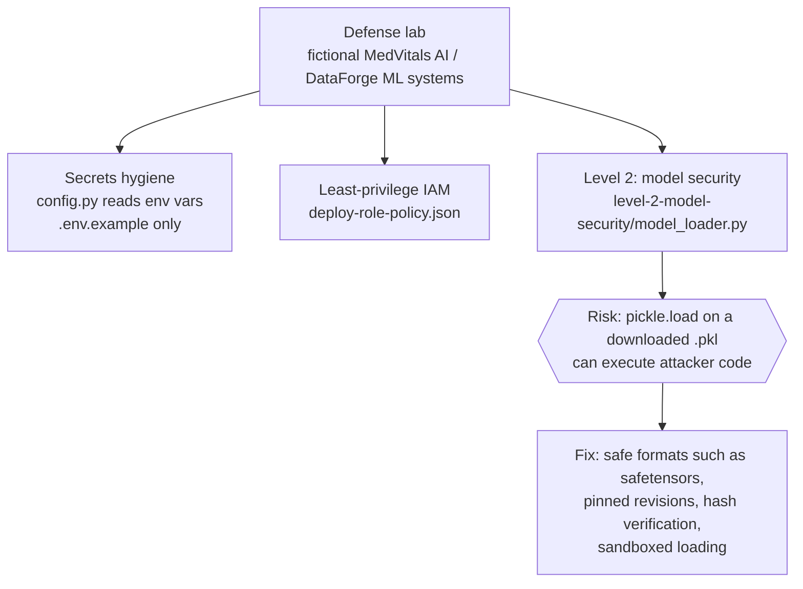

# AI Security Defense Lab

**Hands-on exercises in hardening AI/ML systems: secrets, IAM scope and unsafe model loading.**

   

## Tech stack

  

## Lab map

## What each part teaches

| Path | Topic |
|---|---|
| `config.py`, `.env.example` | Secrets are loaded from environment variables, never committed. |
| `deploy-role-policy.json` | Review an IAM policy for over-broad actions and `Resource: "*"`. |
| `level-2-model-security/model_loader.py` | Intentionally unsafe example: it downloads a `.pkl` model and calls `pickle.load`, which can run attacker-controlled code if the file is malicious. |

> The systems in this lab (MedVitals AI, DataForge ML) are fictional. The loader in `level-2-model-security` is a deliberately vulnerable example, so do not reuse it in real projects.

---

